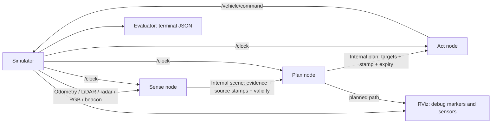
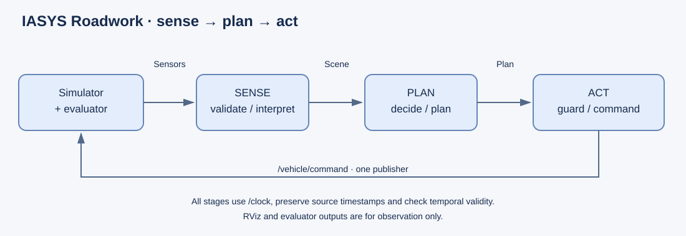
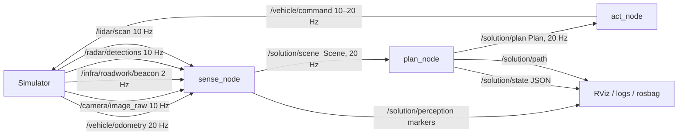
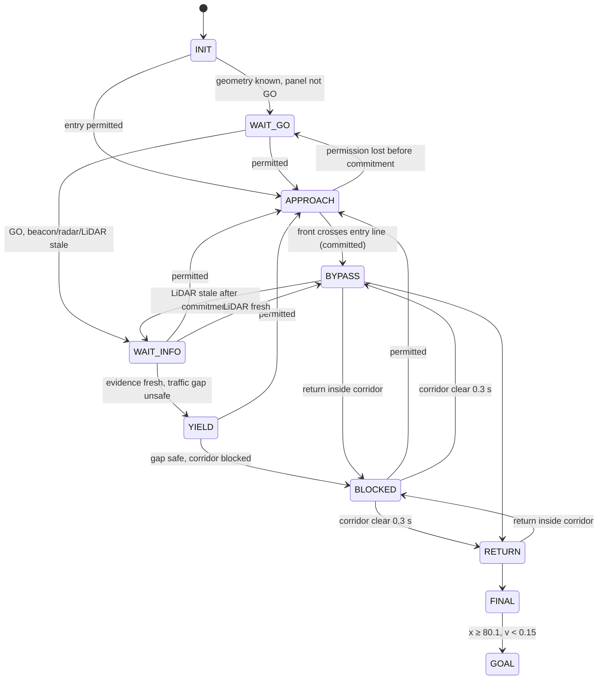

# Required architecture — ROS2 Jazzy

At least **three ROS2 nodes**, in both D1 and D2. The starter launches three
independent C++ executables. Their implementation and the internal ROS message
definitions belong to the students. A single callback invoking three C++ functions
does not satisfy this requirement. Alternative decompositions may add nodes.

Sense subscribes to the external sensor topics, validates messages and derives
perception evidence. Plan subscribes to the internal scene, decides when to enter,
plans the bypass and speed, and exposes its decision state and planned path.
Act subscribes to the plan, executes bounded control targets and is the **only**
publisher of `/vehicle/command`. The reference computes pure-pursuit steering in
Plan and performs command guarding/saturation in Act; students may place tracking
in Act with an additional odometry subscription.

Use internal ROS topics with documented message types, units, frames, QoS, source
timestamps and expiry policy. Do not change `roadwork_interfaces` to conceal an
internal contract in the supplied external messages. Create your own interface
package. Debug markers and evaluator results must never feed the algorithm.

## Implemented architecture (D2, S1–S5)

Three independent C++ executables in `roadwork_student`, each a thin ROS adapter
around ROS-free algorithm headers in `include/roadwork_student/` (unit-tested and
closed-loop-tested without a ROS graph). Internal contracts live in
`roadwork_student_interfaces`; `roadwork_interfaces` is unchanged. The D1 state is
preserved as the git tag `d1-submission`.

| Node | Core (ROS-free) | Inputs | Outputs | Responsibility |
| --- | --- | --- | --- | --- |
| `sense` | `SenseCore` (`sense_core.hpp`, `perception.hpp`) | odometry, camera, beacon, radar, LiDAR | `/solution/scene`, `/solution/perception` | Validate every sample (finite, non-future, non-repeated, well-formed); associate each sensor sample with the ego pose at its own stamp; panel classification with temporal GO confirmation; beacon geometry cache; ego-motion-compensated radar tracking of moving objects; LiDAR projection to `map`, road-edge removal, clustering |
| `plan` | `Planner` (`planning.hpp`) | `/solution/scene` | `/solution/plan`, `/solution/state`, `/solution/path` | Explicit decision state machine (entry permission, commitment, traffic gap, corridor check, information-loss policy), reference path, speed policy, pure-pursuit steering |
| `act` | `CommandGuard` (`control.hpp`) | `/solution/plan` | `/vehicle/command` | Validate plan expiry/age/finiteness, saturate speed and steering, steering slew limit; **only** command publisher |

### Sense

- **Measurement association.** Sense keeps 2 s of odometry. A radar or LiDAR
  sample is transformed with the odometry sample nearest to its acquisition stamp,
  extrapolated at constant speed and heading over the residual gap; a sample more
  than `max_assoc_dt` (0.15 s) from every odometry sample is rejected. In the
  simulator odometry, radar and LiDAR share the tick stamp, so the association is
  exact unless the sensor message is processed before its odometry; then the gap
  is one odometry period (0.05 s, measured: `lidar_pose_dt_max` = 0.05 s in the
  D2 runs). The resulting error is ≤ ½·a·Δt² ≈ 4 mm along track plus a heading
  error of yaw-rate·Δt (≤ 0.015 rad at the bypass curvature), i.e. ≈ 0.18 m
  laterally at 12 m range and ≈ 0.6 m at the 40 m LiDAR limit. Using the newest
  pose for a 0.1 s old scan instead would shift every return by v·Δt ≈ 0.35 m
  along track. Each Scene block keeps its original sensor stamp and the
  association gap (`*_pose_dt`), so Plan judges freshness itself.
- **Panel** (unchanged from D1): single-frame classifier on an inner disc with a
  background-ring check (≥80 % green → GO, ≥80 % red → STOP, otherwise UNKNOWN);
  STOP is immediate; GO needs 3 consecutive frames with stamp gaps ≤ 0.15 s; a
  frame older than 0.30 s turns the published state into UNKNOWN; repeated or
  out-of-order frames are rejected, so old images never accumulate GO evidence.
- **Beacon**: rejects non-finite, future, repeated, out-of-order, geometrically
  inconsistent beacons, `pass_side != +1` and implausible validity intervals;
  caches the newest valid geometry together with its stamp and `valid_for`.
- **Radar**: detections are checked (finite, 0.1–80 m, |az| ≤ 60°). The radial
  velocity includes ego motion: a static object at azimuth `az` reads
  `v_r = -v_ego·cos(az)`, so `v_comp = v_r + v_ego·cos(az)` is the object's own
  velocity along the line of sight. Detections with |v_comp| ≥ 0.6 m/s
  (noise ≤ 0.05 m/s) are moving objects; static returns are left to the LiDAR.
  Traffic is assumed to move along the road, so `vx = v_comp / cos(map bearing)`
  when |cos| ≥ 0.5. Tracks are associated greedily within a 3 m gate around their
  constant-velocity prediction, smoothed, confirmed after 2 updates, deleted after
  3 misses *inside* the FOV, and **coasted** on their prediction while predicted
  outside the ±60° FOV or range (e.g. beside the ego) — a missing detection is
  not an empty road. Coasting tracks are dropped 30 m behind the ego or after 20 s.
- **LiDAR**: the scan layout is validated (≤ one revolution, sane range limits);
  NaN/−inf rays are counted as malformed, +inf is "no return". Returns are
  projected into `map`; returns at the published road edges (|y| ≥ 3.25 m) are
  free-space boundaries and removed. The remaining *obstacle returns* go to Plan
  unchanged (map frame) and are also clustered in beam order (gap ≤ 0.8 m) for
  observability.
- Scenes are published on every accepted odometry sample; a 50 ms timer keeps
  publishing (with `ego_valid=false`) if odometry stops, so Plan sees why.

### Plan: decision model

States (`Plan.state`): `INIT, WAIT_GO, APPROACH, BYPASS, RETURN, FINAL, GOAL,
SAFE_STOP, YIELD, WAIT_INFO, BLOCKED`. Every transition is logged with its time,
position and reason, and `/solution/state` carries the reason and all inputs of the
decision at 20 Hz.

(Waiting states are checked in the order WAIT_GO → WAIT_INFO → YIELD → BLOCKED,
so the reported state names the first unmet condition; SAFE_STOP is reachable from
every state when odometry or the scene is missing/stale.)

**Entry permission** (re-evaluated every cycle before commitment) requires all of:

1. confirmed, fresh GO (`panel_state == GO`);
2. a fresh beacon: age ≤ min(`valid_for`, `beacon_max_age` = 1.2 s). Cached
   geometry plans the path but is never permission;
3. a safe traffic gap certified by fresh radar (age ≤ 0.35 s), see below;
4. fresh LiDAR (age ≤ 0.35 s) and no obstacle return in the corridor of the
   path ahead (40 m).

Without permission the vehicle drives in its own lane and stops with its front
1.0 m before the entry line (`v ≤ √(2·1.0·(d − v·0.15))`, creeping at the end).

**Commitment point**: permission is latched when the vehicle could no longer stop
before the entry line with full braking, `d_line ≤ v·0.15 + v²/(2·3)` (2.57 m at
3.5 m/s). From there the reference path is frozen on the cached geometry.

**Traffic gap (S3)**: the bypass occupies the opposing lane on the path interval
`[opp_lo, opp_hi]` where the ego disc crosses y = 0 (≈ x 30.4–60.2 for
work_shift 0). The ego needs `t_clear` to leave it, computed conservatively
(accelerate at 1.0 m/s² to 3.0 m/s, never faster). A confirmed track with
y > −1.0 m is predicted at constant along-road velocity over
`T = t_clear + 3 s`; if its x-range over `[now, now + T]` overlaps
`[opp_lo − r, opp_hi + r]`, r = 0.9 + 1.0 + 1.0 m, the gap is unsafe. A vehicle
that has passed the interval and moves away never overlaps; one far enough away
lets the ego go first. In the default S3 the gap becomes safe when the oncoming
car passes x ≈ 27.5 m (t ≈ 18.2 s at 3 m/s).

**Corridor check (S5)**: each obstacle return is projected on the nearest path
sample; it blocks the path if it lies within 1.3 m (ego radius + 0.4 m) of the
path and 0–40 m ahead. The work-zone circles stay ≥ 1.8 m from the path, so they
never block it. The first blocking return at arc length `s_block` caps the speed
so the ego stops with its reference 2.5 m before it, braking at 2 m/s² after the
0.15 s control delay. A block is held until the corridor has been clear for
0.3 s (three scans), so one empty scan cannot release the vehicle.

**Information loss.**

| Lost input | Before commitment | After commitment |
| --- | --- | --- |
| camera (blank, ambiguous, stale) | WAIT_GO at the stop line | ignored: GO is latched |
| beacon (stale > 1.2 s) | WAIT_INFO at the stop line | ignored: path frozen on cached geometry |
| radar (stale > 0.35 s) | WAIT_INFO at the stop line | WAIT_INFO before the opposing lane if the ego can still stop there; otherwise continue |
| LiDAR (stale > 0.35 s) | WAIT_INFO at the stop line | WAIT_INFO: brake to 0, resume when fresh |
| odometry (> 0.20 s) or scene (> 0.25 s) | SAFE_STOP (brake, hold steering) | SAFE_STOP |
| plan (Act: expired/old/future/non-finite) | Act commands 0, holds steering | same |

After commitment, a newly conflicting track still makes the ego wait before the
opposing lane (YIELD) if it can stop there; inside the opposing lane the corridor
check is the remaining safeguard.

**Recovery and reset.** Every waiting state is re-evaluated each cycle, so the
vehicle proceeds as soon as fresh evidence satisfies the conditions (S4: GO is
re-confirmed 0.2 s after the camera returns; S5: the corridor is released 0.3 s
after the obstacle disappears). Each episode is a fresh launch. If `/clock` jumps
backwards (simulator restarted under running nodes), every node discards its
episode state: filters, tracks, latched GO, frozen path, steering memory.
Restarting only Plan mid-crossing loses the commitment, so reset the whole
episode instead.

### Plan: path, speed and steering

- **Path**: own lane → left bypass (y = +1.25) → own lane, using quintic
  smootherstep transitions (continuous curvature). Built from the beacon
  geometry, so it follows `work_shift`; rejected if the lane changes would be too
  short or need more than the steering limit.
- **Speed**: minimum of cruise (3.5 m/s), curvature and steering-rate limits looked
  ahead 15 m, the goal braking profile, the stop-line, yield and obstacle caps, and
  beacon limit − 0.3 m/s. Act additionally caps at 3.8 m/s (violation at 4.05).
- **Stopping distances and delay margins**: all profiles subtract `v·0.15 s` for
  control delay. At 3.5 m/s: full braking 2.04 m (+0.53 m delay); obstacle profile
  (2 m/s²) 3.06 m + 0.53 m + 2.5 m standoff, so braking starts about 6.1 m before
  the first blocking return. The S5 obstacle appears ≥ 12 m ahead and is detected
  on the next 10 Hz scan (measured 0–0.1 s), leaving ≈ 6 m of margin, well above
  the ≈ 0.9 m travelled during a 0.25 s sensing + transport + command delay.
- **Steering**: pure pursuit on the rear axle, look-ahead 3–6 m speed-dependent.
- A 50 ms watchdog publishes a hold plan if no scene arrives within `scene_timeout`.

### Act

Every plan triggers a command; a 50 ms timer guarantees commands at ≥ 10 Hz even
without plans (measured ≈ 21 Hz). If the plan is missing, non-finite,
future-stamped, expired (`valid_until`) or older than `max_plan_age`, Act commands
speed 0 and holds steering itself instead of relying on the simulator watchdog.
Speed is capped at min(`max_speed` 3.8, `Plan.speed_limit`); steering at
±0.45 rad with 0.6 rad/s slew.

### Model limitations and residual risks

- Odometry is exact and the collision geometry is a disc. The path clearances do
  not transfer to a real vehicle footprint or to localisation error.
- The LiDAR is 2D (no elevation, no ground); returns at |y| ≥ 3.25 m are treated
  as road edge, so an object touching the road edge is invisible to the corridor
  check (it cannot be in the corridor either).
- The radar is idealised: one detection per object, no occlusion, multipath or
  clutter. Tracks assume along-road motion with constant y; a crossing or
  lane-changing vehicle would be mispredicted.
- The gap check only knows traffic within radar range (80 m). From the stop line a
  vehicle more than 80 m ahead driving faster than ≈ 2.4 m/s could reach the
  opposing-lane interval before the ego clears it. The S3 vehicle starts within
  range, but this is a real limit of the method.
- After commitment, the only response to an oncoming vehicle inside the opposing
  lane is braking (corridor check). This stops the ego but cannot avoid a vehicle
  that keeps coming; the scenarios never combine S3 traffic with an S5-style late
  event.
- The panel is a crop, not a perception problem; recognition results on generated
  images do not establish real-world recognition accuracy. Simulated success does
  not establish real-world vehicle safety.

### Tests

`colcon test --packages-select roadwork_student` runs three ROS-free test
executables: `test_perception` (panel confusion matrix on held-out generated
images, malformed images, temporal filter, beacon validation, radar compensation
and tracking incl. coasting, LiDAR projection/clustering/association, SenseCore),
`test_planning` (path geometry, decisions, traffic gap, information loss,
corridor check, command guard) and `test_closed_loop` (full Sense→Plan→Act loop
against `roadwork_core`, fed only with the observation fields a solution may use:
378 runs over S1–S5 × seeds 1–3 × work_shift {0, ±2} × noise {0, 0.02, 0.05} ×
extra command delay {0, 0.1 s}, S3 also × traffic_speed {2, 3, 4}). The test
asserts S2 stops at the line and S4 enters only after the blackout.
