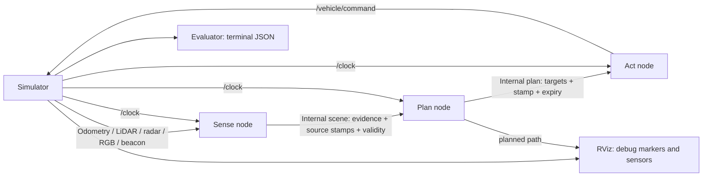
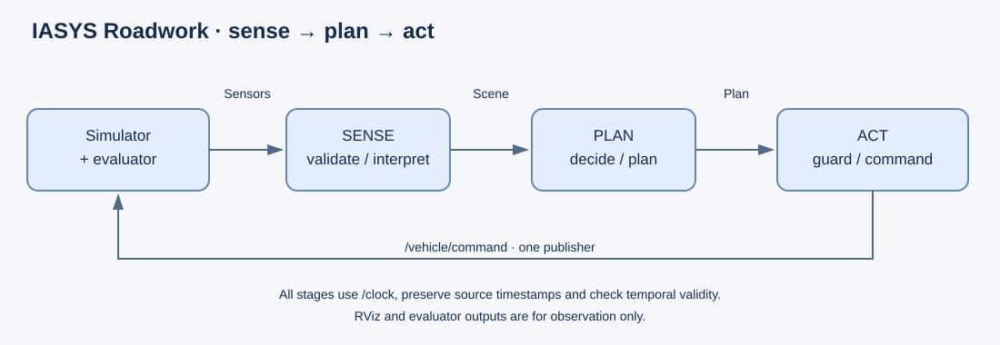
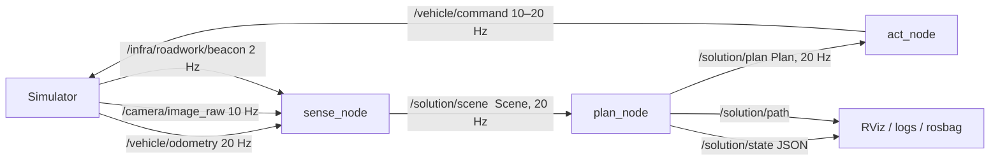

# Required architecture — ROS2 Jazzy

At least **three ROS2 nodes**, in both D1 and D2. The starter launches three
independent C++ executables. Their implementation and the internal ROS message
definitions belong to the students. A single callback invoking three C++ functions
does not satisfy this requirement. Alternative decompositions may add nodes.

Sense subscribes to the external sensor topics, validates messages and derives
perception evidence. Plan subscribes to the internal scene, decides when to enter,
plans the bypass and speed, and exposes its decision state and planned path.
Act subscribes to the plan, executes bounded control targets and is the **only**
publisher of `/vehicle/command`. The reference computes pure-pursuit steering in
Plan and performs command guarding/saturation in Act; students may place tracking
in Act with an additional odometry subscription.

Use internal ROS topics with documented message types, units, frames, QoS, source
timestamps and expiry policy. Do not change `roadwork_interfaces` to conceal an
internal contract in the supplied external messages. Create your own interface
package. Debug markers and evaluator results must never feed the algorithm.

## Implemented architecture (D1, S1–S2)

Three independent C++ executables in `roadwork_student`, each a thin ROS adapter
around ROS-free algorithm headers in `include/roadwork_student/` (unit-tested
without a ROS graph). Internal contracts live in `roadwork_student_interfaces`;
`roadwork_interfaces` is unchanged.

| Node | Core (ROS-free) | Inputs | Outputs | Responsibility |
| --- | --- | --- | --- | --- |
| `sense` | `SenseCore` (`sense_core.hpp`, `perception.hpp`) | odometry, camera, beacon | `/solution/scene` | Validate every sample (finite, non-future, non-repeated, well-formed); classify the panel; temporal GO confirmation; cache beacon geometry |
| `plan` | `Planner` (`planning.hpp`) | `/solution/scene` | `/solution/plan`, `/solution/state`, `/solution/path` | Decision state machine, reference path, speed profile, pure-pursuit steering |
| `act` | `CommandGuard` (`control.hpp`) | `/solution/plan` | `/vehicle/command` | Validate plan expiry/age/finiteness, saturate speed and steering, steering slew limit; **only** command publisher |

### Sense

- **Panel**: single-frame classifier counts strongly green / red pixels in an
  inner disc and rejects frames whose outer ring is coloured. ≥80 % green → GO,
  ≥80 % red → STOP, anything else → UNKNOWN.
- **Temporal filter** (`PanelFilter`): STOP is reported immediately; GO only after
  `go_confirm_frames` (3) consecutive GO frames with stamp gaps ≤0.15 s. A frame
  older than `camera_timeout` (0.30 s) turns the published state into UNKNOWN, so
  an expired GO frame never remains permission.
- **Beacon** (`BeaconMonitor`): rejects non-finite, future, repeated, out-of-order
  or geometrically inconsistent beacons and `pass_side != +1`; caches the newest
  valid geometry.
- Scenes are published on every accepted odometry sample. A 50 ms timer keeps
  publishing (with `ego_valid=false`) if odometry stops, so Plan sees why.

### Plan

State machine (`Plan.state`):

- STOP, UNKNOWN or stale panel evidence keeps the vehicle in WAIT_GO with
  `hold=true`. In S2 the vehicle therefore stays at the start pose until the panel
  has shown GO for three frames, well before the entry line x=25.
- GO is latched once confirmed, and the path geometry is frozen at that moment.
- **Path**: own lane → left bypass (y=+1.25) → own lane, using quintic smootherstep
  transitions (continuous curvature). Built from beacon geometry, so it follows
  `work_shift`; rejected if the lane changes would be too short or exceed steering
  capability.
- **Speed**: minimum of cruise (3.5 m/s), curvature/steering-rate limits looked
  ahead 15 m, a goal braking profile, and beacon limit −0.3 m/s.
- **Steering**: pure pursuit on the rear axle, look-ahead 3–6 m speed-dependent.
- A 50 ms watchdog publishes a hold plan if no scene arrives within `scene_timeout`.

### Act

Every plan triggers a command; a 50 ms timer guarantees commands at ≥10 Hz even
without plans. If the plan is missing, non-finite, future-stamped, expired
(`valid_until`) or older than `max_plan_age`, Act commands speed 0 and holds
steering itself instead of relying on the simulator watchdog. Speed is capped at
min(`max_speed` 3.8, `Plan.speed_limit`); steering at ±0.45 rad with 0.6 rad/s slew.

### Not yet implemented (outside D1 scope)

LiDAR and radar are not subscribed; there is no obstacle detection, gap check
for opposing traffic (S3), stale-beacon handling before entry (S4) or braking for
obstacles during traversal (S5). Before entry, Plan relies on fresh camera
evidence; beacon freshness is not yet checked at commitment.

### Tests

`colcon test --packages-select roadwork_student` runs three ROS-free test
executables: `test_perception` (panel confusion, malformed images, temporal
filter, beacon validation, SenseCore), `test_planning` (path geometry, decisions,
command guard) and `test_closed_loop` (full Sense→Plan→Act loop against
`roadwork_core`: 108 runs over S1–S2 × seeds 1–3 × work_shift {0, ±2} × noise
{0, 0.02, 0.05} × extra command delay {0, 0.1 s}; S2 also requires first motion
at t ≥ 10 s).
